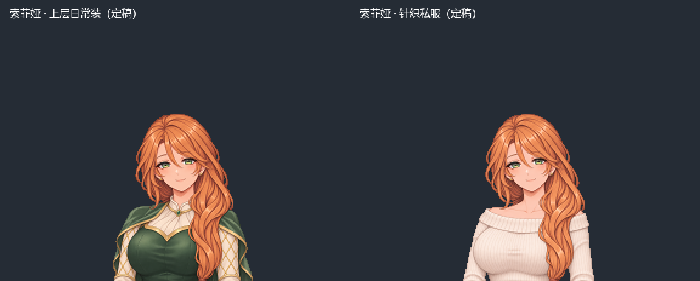

# 索菲娅两套定稿导入

2026-11-11。用户最新指令：“不再继续等待，使用现有两版作为定稿导入游戏”。采用已完成的v3翡翠绿上层装与v4奶油白露肩针织私服；停止v5脸部/发型/黑高领重设计，本地请求已结束，没有返回图片，不自动重试。

## 定稿与资源

索菲娅实际38岁、外表约28岁，铜红长发、绿眼。保留两套现有脸、发型与体型，不再生成。本次接受现有两版，胸围相对Lydia未另作精确测量。

| 用途 | 运行资源键 | 定稿版本 | 肖像 SHA-256 |
| --- | --- | --- | --- |
| 公开来访日常 | `er_portrait_mother_female_beauty` | v3上层装 | `ad72ae43dddd3306586606f5a7b2738179f1591fe6c03b6f9ec4dda6e3b00364` |
| 居家/私服 | `er_portrait_mother_home_female_beauty` | v4针织私服 | `69b1ddab3c9c3694fc39525f2a1c6084676a1289e74c753a0ae60b5532c95d44` |

正式文件位于项目 `Textures/Items/`，均为288×212、8位RGBA、alpha仅0/255。v3沿用已有日常资源键，直接替换老脸。v4新增独立键，不覆盖日常装。

高清母图、正式PNG、来源版本和批准哈希冻结于 `approved/`；总清单为 [approval.json](approved/approval.json)。原始母图仍保存在 `masters/`。旧母亲美化与原版画像另存 `retired_before_install/`，候选时期的状态记录保留在 `history_before_approval/`。

## 场景与兼容

- `er_story_mother` 和 `er_story_maid_m17` 均为公开到店采购，使用日常上层装；原有剧情、路线和数值不变。
- 私服已作为可加载游戏资源导入，独立入口为 `PortraitCompat.ResolveMotherHome()`。当前没有实装的居家场景调用它，本次不新增剧情或解锁条件。
- 旧档中的母亲历史美化/原版键重新解析；上述两次母亲来访若保存了通用 `femaleUpper3` 或少女当铺别名，也会更新为当前日常选择。其他普通NPC不受影响。
- 私服键载入后仍解析为私服，不会被清理成日常。缺少私服先回退定稿日常，再回退原游戏画像。
- 两套定稿均属于美化风格，仅在少女当铺启用或Nexus美化版中选择。独立新原版图尚未制作，无少女当铺时暂沿用既有 `femaleUpper3`；旧 `_vanilla` 文件不主动显示，也不把美化母图减色充当原版。

## 验证

- Release编译：0警告、0错误。
- 中英文本与内容引用静态检查通过。
- 43张运行PNG资源审计：0标记问题；27张既有表情轮廓与基础像保持一致。本轮只替换母亲日常图、增加母亲私服图，其他41张PNG与开始前完全一致，见 `workspace_install.json`。
- 两套均重新通过作者B/detail导出，输出与批准PNG逐字节一致，重复导出像素一致。固定 `s=0.125, tx=77.8125, ty=72.6875`，288×211采样后顶部补一行；没有减色、洋红抠图或改变脸部缩放。
- 查看定稿原生2倍同框，沿用此前已检查的母图、同坐标脸部及黑/白/灰底预览；未声称实际游戏UI已验收。
- `tools/test_mother_portraits.ps1` 执行真实编译程序集的服装选择与旧档清理代码，仅替换美化检测/Unity资源加载边界。公开来访调用、日常/私服选择、旧键和通用键升级、私服保留、缺图回退、美化禁用/重启用均通过。
- 全剧情回归 `tools/test_runtime_flows.ps1 -Maid -Dual` 在既有第103章用例报 `Chapter 103 has no bargaining`，未通过；对导入前游戏目录里的DLL重复检查也在同处失败，确认该问题在本次导入前已存在，保留记录，不改动革命军剧情。

复现导出命令：

```powershell
python Art/mother-redesign-2026-11-11/export_preview.py --revision v3
python Art/mother-redesign-2026-11-11/export_preview.py --revision v4_intimate
pwsh -File tools/test_mother_portraits.ps1 -Managed 'B:\Probably Stolen_Data\Managed'
```

导出器安装后按批准清单检查两张正式图，并继续保护其他运行PNG，不再错误要求所有资源与安装前完全一致。导出只写美术目录，不自动覆盖游戏资源。

## 本地部署

2026-11-11激活报错修复：此前为替换运行中占用的DLL，将旧DLL改名为 `.bak` 留在模组根目录；游戏仍按可执行内容扫描并拒绝加载。现已将该备份移到工作区 `dist/mother_portraits_local_20261111-214206/removed_from_mod_scan/`，原备份另保留在 `before/`。实际安装目录重新通过游戏原生扫描：1515方法，未拒绝、0硬标记、0发现、0能力申请。其他50个安装文件哈希不变，存档未改动。见 `scan_blocker_fix.json`、`native_scan_after_fix.json`。此前的文件一致性与专项测试未覆盖目录残留扫描，已补充此项部署要求。

本地目标为已安装的本MOD订阅目录：`D:\Program Files (x86)\Steam\steamapps\workshop\content\4348910\3834588749`。只同步本次DLL、两张定稿画像与README；manifest、Localization和其他PNG在同步前与项目基线一致，无需覆盖。

部署前备份与逐文件哈希见 `local_deployment.json`。保留0.91版本号，不修改已发布包，不向工坊、GitHub或Nexus发布。

游戏当前仍在运行，未结束游戏或改写存档。磁盘同步后需正常保存、退出并重启游戏，且启用少女当铺，才能加载新DLL与画像；实机显示验收仍待重启后进行。


